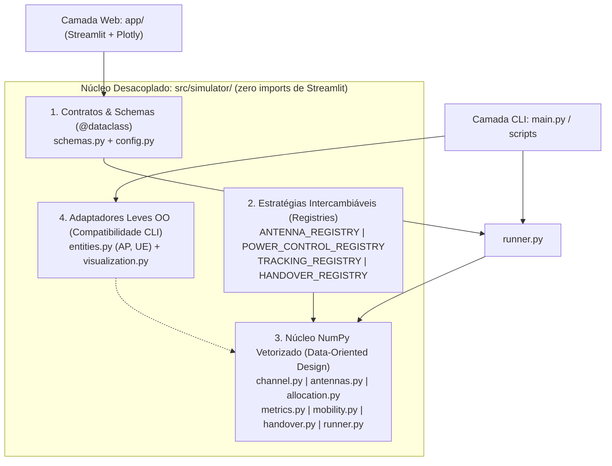

# Arquitetura Híbrida do Mobile Network Simulator

Este documento descreve a **arquitetura híbrida em 4 camadas** do `mobile-network-simulator` (GTEL/UFC), integrando simulação matricial vetorizada de alto desempenho em NumPy, retrocompatibilidade com a linha de comando (`main.py`) e uma interface gráfica web modular em **Streamlit + Plotly**.

---

## 1. Visão Geral em 4 Camadas



### Princípios Arquiteturais
1. **Contratos Fortemente Tipados (`schemas.py`):** Toda configuração editável da interface ou de experimentos programáticos é encapsulada em `@dataclass` imutáveis/validáveis (`ChannelConfig`, `AntennaConfig`, `PowerControlConfig`, `MobilityConfig`, `HandoverConfig`, `SimulationConfig`) com serialização `to_json()` / `from_json()`. Todas as saídas usam contratos consistentes (`SnapshotResult`, `MonteCarloResult`, `MobilityResult`, `SDMAResult`, `HandoverResult`), eliminando inconsistências de chaves (`K` vs `'K=1'`).
2. **Padrão *Strategy* / Registry:** Antenas (`"omni"`, `"sector"`, `"smb"`, `"mrc"`, `"ula"`, `"adaptive_1"`, `"adaptive_5"`, `"adaptive_10"`), controle de potência (`"full_power"`, `"cipc"`, `"optimal"`, `"dpc_fixed"`, `"dual_loop"`, `"max_sum"`, `"max_prod"`), rastreamento de feixe (`"hold"`, `"predictive"`) e handover (`"hard"`, `"soft"`) são despachados via dicionários de estratégias para funções puras vetorizadas.
3. **Data-Oriented Design (NumPy Puro):** Todos os laços quentes de Monte Carlo e o motor *time-driven* (`dt = 1 ms`) operam exclusivamente sobre arrays NumPy (`ue_xy (K, 2)`, `ap_xy (M, 2)`, `gains (K, M, B)`, `G_eff (K, K)`), sem instanciar objetos Python `AP`/`UE` nos loops internos.
4. **Desacoplamento Estrito:** Nenhum módulo em `src/simulator/` importa `streamlit` ou força `plt.show()`. O módulo `visualization.py` retorna objetos `matplotlib.figure.Figure` (`show=False` por padrão).

---

## 2. Estrutura de Diretórios

```text
mobile-network-simulator/
├── src/
│   └── simulator/
│       ├── __init__.py          # API pública híbrida + wrappers legados CLI
│       ├── config.py            # Constantes físicas default, paletas e parâmetros de mobilidade
│       ├── schemas.py           # Dataclasses de entrada (Configs) e saída (Results) + JSON
│       ├── entities.py          # Classes AP e UE (adaptadores leves p/ retrocompatibilidade CLI)
│       ├── channel.py           # Distâncias, azimutes, Path Loss, Shadowing/Rayleigh opcionais e G_eff
│       ├── antennas.py          # Omni, Setorial, SMB (UCA), MRC (UCA), ULA 1D/2D e lóbulos de plotagem
│       ├── allocation.py        # Attach, canais (Full Reuse, Random, PAPOA, PAPOA+CA) e Controle de Potência
│       ├── metrics.py           # SINR vetorizado, Shannon, limites físicos QAM/Outage, Jain e ASE
│       ├── mobility.py          # Motor time-driven (dt=1ms), Tracking Preditivo (α-β) e SDMA (MRC vs. ZF)
│       ├── handover.py          # Motor Hard vs. Soft Handover (seleção e macro-diversidade), Histerese e TTT
│       ├── runner.py            # Snapshot único, Heatmap corrigido, Monte Carlo (+callback) e wrappers CLI
│       └── visualization.py     # Gráficos Matplotlib retornando `fig` para uso via CLI
├── app/                         # Camada exclusiva da Interface Web (Streamlit + Plotly)
│   ├── main_app.py              # Entrypoint Streamlit, st.session_state e layout em 6 abas
│   ├── components/
│   │   ├── sidebar.py           # Todos os controles editáveis, presets dos roteiros e JSON
│   │   └── charts.py            # Fábrica Plotly (Mapa 2D/3D, CDFs, KPIs 2x2, Mobilidade, HO, Convergência)
│   └── tabs/
│       ├── tab_snapshot.py      # TELA 1: Mapa Interativo do Snapshot + Gráficos do Monte Carlo abaixo
│       ├── tab_cdfs.py          # Aba 2: CDFs Comparativas detalhadas por carga K
│       ├── tab_kpis.py          # Aba 3: Painel 2x2 de KPIs + Tabela + Exportação CSV/JSON
│       ├── tab_mobility.py      # Aba 4: Mobilidade, Beam Tracking (Hold vs. Preditivo), Trade-off e SDMA
│       ├── tab_handover.py      # Aba 5: Handover (Hard vs. Soft) e detecção de Outage
│       └── tab_convergence.py   # Aba 6: Convergência passo a passo (Dual-Loop / DPC / MaxSum / MaxProd)
├── tests/
│   ├── test_physical_sanity.py  # 17 testes de invariantes físicos, determinismo e desacoplamento
│   └── test_app_streamlit.py    # Testes E2E via Streamlit AppTest e validação de hover Plotly
├── main.py                      # Entrypoint CLI preservado
├── scichal.py                   # Script de referência histórico
├── research-activity-01.py      # Script de referência da Atividade 1
├── research-activity-02.py      # Script de referência da Atividade 2
├── pyproject.toml               # Empacotamento (pip install -e .) e configuração Ruff/Pytest
└── requirements.txt             # Dependências runtime
```

---

## 3. Detalhamento dos Módulos (`src/simulator/`)

### `schemas.py` e `config.py`
- **`ChannelConfig`**: `use_shadowing`, `sigma_x`, `use_rayleigh`, `sigma_r`, `pathloss_exp (n)`, `k_const (k)`, `d_0`, `b_total_hz`, `k_0`.
- **`AntennaConfig`**: `models`, `L` (elementos UCA/ULA), `J` (feixes SMB), `aoa_err_deg`, `beamwidth_deg`, `g_min`.
- **`PowerControlConfig`**: `algorithms`, `p_max_dbm`, `p_min_dbm`, `mu_step_db`, `gamma_tar_init_db`, `gamma_max_db`, `gamma_min_db`, `t_outer`, `t_inner`, `tol_db`, `apply_physical_limits`.
- **`MobilityConfig`**: `dt_s` (1 ms), `t_sim_s` (4 s), `t_overhead_s` (1,5 ms), `sigma_theta_deg` (1° default), `compare_predictive`, `enable_sdma`, `sdma_k_ues`, `sdma_combiner` (`"mrc"`, `"zf"`, `"both"`).
- **`HandoverConfig`**: `num_aps`, `dist_total_m`, `velocity_ms`, `t_sample_s`, `p_min_w`, `hysteresis_db`, `active_set_margin_db`, `ttt_ms`, `soft_combining` (`"selection"` | `"macro_diversity"`), `mc_runs`.
- **`SimulationConfig`**: Agrega todas as subconfigurações, valida invariantes (`M` quadrado perfeito, `P_min <= P_max`, `gamma_min < gamma_max`, etc.) e oferece `to_json()` / `from_json()`.

### `channel.py` e `antennas.py`
- **`antennas.py`**: Centraliza `omni_gains`, `sector_gains`, `smb_gains` (UCA), `mrc_gain` (UCA), `calc_ula_gain` (ULA 1D broadside para mobilidade) e `ula_2d_gain` (ULA 2D orientado radialmente na grade celular), além de `compute_beam_lobe_xy()` para plotagem exata dos diagramas de irradiação (sem aproximações lineares artificiais).
- **`channel.py`**: Calcula `distance_matrix`, `angle_matrix`, `gerar_shadowing`, `gerar_rayleigh`, `gain_matrix` (com *Shadowing* e *Rayleigh* ligáveis/desligáveis e reutilização determinística do mesmo canal via `rng`) e `adaptive_gains_vec` (suportando tanto UCA quanto ULA e erro gaussiano de AoA).

### `allocation.py` e `metrics.py`
- **Alocação de Canais (`allocate_channels_vec`)**: `"full_reuse"`, `"random"`, `"papoa"` (Part 2 Ex. 6) e `"papoa_ca"` (*Carrier Aggregation*, Part 2 Ex. 7), todas usando `np.random.Generator` para determinismo completo.
- **Controle de Potência (`POWER_CONTROL_REGISTRY`)**:
  - `"full_power"`: Potência máxima $P_{\max}$ constante.
  - `"cipc"`: *Channel Inversion Power Control* (Part 2 Ex. 9).
  - `"optimal"`: Controle Ótimo de Potência por inversão da matriz $(I - \gamma_{\text{tar}} F)$ com *fallback* para CIPC quando inviável (Part 2 Ex. 10–11).
  - `"dpc_fixed"`: *Distributed Power Control* com alvo $\gamma_{\text{tar}}$ fixo.
  - `"dual_loop"`: *Dual-Loop Power Control* fiel ao roteiro `SciChal4A.pdf` — loop interno com passos discretos $\pm \mu$ dB, loop externo reduzindo $\gamma_{\text{tar}}$ em $-1$ dB para UEs insatisfeitos em $P_{\max}$, e bloqueio (`p_k = 0 W`, gerando **zero interferência** aos sobreviventes) quando $\gamma_{\text{tar}} < \gamma_{\min}$. Suporta gravação completa do histórico (`record_history=True`) para a Aba 6.
  - `"max_sum"` e `"max_prod"`: Otimização de soma e produto de capacidades (Parte 3 — RRM).
- **Métricas (`metrics.py`)**: `calculate_sinr_vector`, `evaluate_physical_kpis` (com *checkbox* `apply_physical_limits` aplicando teto de saturação QAM $\gamma_{\max}$ e corte de outage $\gamma_{\min}$), `jain_fairness` e `area_spectrum_efficiency` (ASE).

### `mobility.py` e `handover.py`
- **`mobility.py`**: Motor *time-driven* (`dt = 1 ms`) fiel à Atividade 2 (`x(t) = v (t - T_sim/2)`, `y = D`, ULA com $d = \lambda/2$):
  - Compara **Zero-Order Hold** (`"hold"`, atraso $\Delta T$) contra **Rastreamento Preditivo** (`"predictive"`, filtro $\alpha\text{-}\beta$ adaptativo extrapolando $\hat{\theta}(t) = \hat{\theta}_k + \hat{\omega}_k \Delta t$ entre atualizações).
  - Calcula a **Eficiência Espectral Líquida** descontando o *overhead* de treinamento: $\text{SE}_{\text{net}} = (1 - T_{\text{ovh}}/\Delta T)\,\log_2(1 + \text{SNR}(t))$.
  - Motor **SDMA Multi-usuário Móvel** (`run_mobile_sdma`): $K \ge 1$ UEs móveis com trajetórias distintas comparando combinadores **MRC** vs. **Zero-Forcing** regularizado ($\mathbf{W}_{\text{ZF}} = \mathbf{H}(\mathbf{H}^H\mathbf{H} + \alpha\mathbf{I})^{-1}$) em cada passo `dt`.
- **`handover.py`**: Travessia linear entre $M \ge 2$ APs (Parte 2 Ex. 12–13) comparando **Hard Handover** (com histerese em dB e *Time-to-Trigger* em ms opcionais) e **Soft Handover** (seleção ótima ou macro-diversidade por *Active Set*), contabilizando taxa de outage, eventos de troca (*ping-pong*) e ganho médio de SNR.

### `runner.py`
- **`run_single_snapshot()`**: Constrói um `SnapshotResult` completo (UEs, APs com lista exata de UEs conectados, Sum-Capacity por célula, contagem de outages, histórico de convergência e *heatmap* de cobertura opcional com ganho linear correto para SMB/MRC/ULA).
- **`run_monte_carlo()`**: Orquestra baterias vetorizadas em múltiplas cargas $K$ com `progress_callback(frac, msg)`, sorteando a geometria e o canal (shadowing + Rayleigh) uma única vez por rodada para comparação estatística justa entre modelos. Separa limpo `power_metrics` e `antenna_metrics` conforme `comparison_mode` (`"power"`, `"antennas"`, `"both"`), evitando explosão combinatória, e armazena o índice do **Inspetor de Rodadas** (melhor, mediana, pior, 1ª, última e rodada `#k`).

---

## 4. Camada Web (`app/`) — Streamlit + Plotly

- **Tela 1 (`tab_snapshot.py`)**: Abre imediatamente com o **Mapa Interativo 2D** do Snapshot atual (com alternância opcional para **3D + Heatmap**). Todos os traços auxiliares (linhas UE↔AP, grade de células, lóbulos de antena, interferência CCI e heatmap) usam `hoverinfo="skip"`, garantindo que o *hover* rico nos **UEs** (ID, posição, AP, distância, AoA, canal, potência Tx, ganho, SINR, SE, capacidade, meta $\gamma_{\text{tar}}$, status) e nos **APs** (ID, posição, quantidade de UEs, lista exata de UEs conectados, Sum-Capacity da célula e outages) responda instantaneamente. Após clicar em **▶️ Executar Monte Carlo**, o mapa permanece no topo e os gráficos comparativos (painel 2×2 de KPIs e CDFs) aparecem imediatamente abaixo.
- **Performance reativa**: As simulações das abas de Mobilidade (`tab_mobility.py`) e Handover (`tab_handover.py`) usam `@st.cache_data` indexado pelas dataclasses de configuração, eliminando recomputações ao interagir com a Tela 1 ou demais abas.
- **Presets & JSON**: A barra lateral inclui presets prontos dos roteiros (`SciChal4A`, Parte 2 Ex. 6–7, Parte 2 Ex. 9–11, Parte 3 RRM, Parte 4 Ex. 1–4) além de exportação/importação completa da configuração em JSON.
