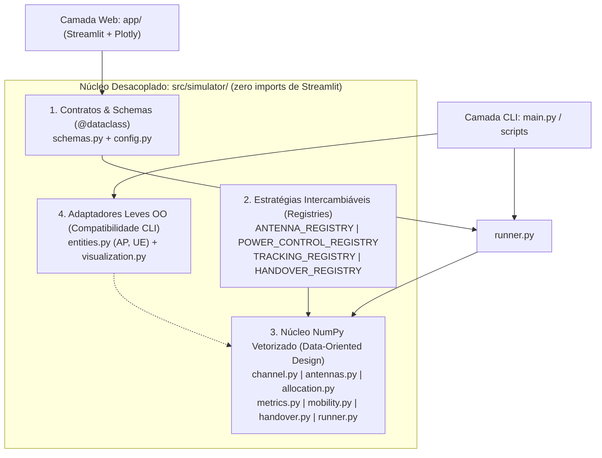

# Arquitetura Híbrida do Mobile Network Simulator

Este documento descreve a **arquitetura híbrida em 4 camadas** do `mobile-network-simulator` (GTEL/UFC), integrando simulação matricial vetorizada de alto desempenho em NumPy, retrocompatibilidade com a linha de comando (`main.py`) e uma interface gráfica web modular em **Streamlit + Plotly**.

---

## 1. Visão Geral em 4 Camadas



### Princípios Arquiteturais
1. **Contratos Fortemente Tipados (`schemas.py`):** Toda configuração editável da interface ou de experimentos programáticos é encapsulada em `@dataclass` imutáveis/validáveis (`ChannelConfig`, `AntennaConfig`, `PowerControlConfig`, `MobilityConfig`, `HandoverConfig`, `SimulationConfig`) com serialização `to_json()` / `from_json()`. Todas as saídas usam contratos consistentes (`SnapshotResult`, `MonteCarloResult`, `MobilityResult`, `SDMAResult`, `HandoverResult`), eliminando inconsistências de chaves (`K` vs `'K=1'`).
2. **Padrão *Strategy* / Registry:** Antenas (`"omni"`, `"sector"`, `"smb"`, `"mrc"`, `"ula"`, `"adaptive_1"`, `"adaptive_5"`, `"adaptive_10"`), controle de potência (`"full_power"`, `"cipc"`, `"optimal"`, `"dpc_fixed"`, `"dual_loop"`, `"max_sum"`, `"max_prod"`), rastreamento de feixe (`"hold"`, `"predictive"`) e handover (`"hard"`, `"soft"`) são despachados via dicionários de estratégias para funções puras vetorizadas.
3. **Data-Oriented Design (NumPy Puro):** Todos os laços quentes de Monte Carlo e o motor *time-driven* (`dt = 1 ms`) operam exclusivamente sobre arrays NumPy (`ue_xy (K, 2)`, `ap_xy (M, 2)`, `gains (K, M, B)`, `G_eff (K, K)`), sem instanciar objetos Python `AP`/`UE` nos loops internos.
4. **Desacoplamento Estrito:** Nenhum módulo em `src/simulator/` importa `streamlit` ou força `plt.show()`. O módulo `visualization.py` retorna objetos `matplotlib.figure.Figure` (`show=False` por padrão).

---

## 2. Estrutura de Diretórios

```text
mobile-network-simulator/
├── src/
│   └── simulator/
│       ├── __init__.py          # API pública híbrida + wrappers legados CLI
│       ├── config.py            # Constantes físicas default, paletas e parâmetros de mobilidade
│       ├── schemas.py           # Dataclasses de entrada (Configs) e saída (Results) + JSON
│       ├── entities.py          # Classes AP e UE (adaptadores leves p/ retrocompatibilidade CLI)
│       ├── channel.py           # Distâncias, azimutes, Path Loss, Shadowing/Rayleigh opcionais e G_eff
│       ├── antennas.py          # Omni, Setorial, SMB (UCA), MRC (UCA), ULA 1D/2D e lóbulos de plotagem
│       ├── allocation.py        # Attach, canais (Full Reuse, Random, PAPOA, PAPOA+CA) e Controle de Potência
│       ├── metrics.py           # SINR vetorizado, Shannon, limites físicos QAM/Outage, Jain e ASE
│       ├── mobility.py          # Motor time-driven (dt=1ms), Tracking Preditivo (α-β) e SDMA (MRC vs. ZF)
│       ├── handover.py          # Motor Hard vs. Soft Handover (seleção e macro-diversidade), Histerese e TTT
│       ├── runner.py            # Snapshot único, Heatmap corrigido, Monte Carlo (+callback) e wrappers CLI
│       └── visualization.py     # Gráficos Matplotlib retornando `fig` para uso via CLI
├── app/                         # Camada exclusiva da Interface Web (Streamlit + Plotly)
│   ├── main_app.py              # Entrypoint Streamlit, st.session_state e layout dinâmico (5 ou 7 abas)
│   ├── components/
│   │   ├── sidebar.py           # Controles editáveis, escopo automático, presets dos roteiros e JSON
│   │   └── charts.py            # Fábrica Plotly (Mapa 2D/3D, KPIs Snapshot/MC, Baseline, Rede Móvel, HO)
│   └── tabs/
│       ├── tab_snapshot.py      # Aba 1: Mapa 2D/3D + Cards Agrupados + Comparativo Instantâneo + MC
│       ├── tab_kpis.py          # Aba 2: KPIs Instantâneos do Snapshot (2x2) + Benchmark Antenas & Potência
│       ├── tab_cdfs.py          # Aba 3: CDFs Comparativas (Antenas e/ou Controle de Potência)
│       ├── tab_users.py         # Aba 4: Tabela de UEs/APs com busca, filtros e Inspetor de Rodadas
│       ├── tab_convergence.py   # Aba 5: Convergência passo a passo (Dual-Loop / DPC / MaxSum / MaxProd)
│       ├── tab_mobility.py      # Aba 6 (Modo Móvel): Mobilidade, Beam Tracking & SDMA na Rede Completa
│       └── tab_handover.py      # Aba 7 (Modo Móvel): Handover Hard vs. Soft na Rede Completa (M × K)
├── tests/
│   ├── test_physical_sanity.py  # 17 testes de invariantes físicos, determinismo e desacoplamento
│   └── test_app_streamlit.py    # Testes E2E via Streamlit AppTest e validação de hover Plotly
├── main.py                      # Entrypoint CLI preservado
├── scichal.py                   # Script de referência histórico
├── research-activity-01.py      # Script de referência da Atividade 1
├── research-activity-02.py      # Script de referência da Atividade 2
├── pyproject.toml               # Empacotamento (pip install -e .) e configuração Ruff/Pytest
└── requirements.txt             # Dependências runtime
```

---

## 3. Detalhamento dos Módulos (`src/simulator/`)

### `schemas.py` e `config.py`
- **`ChannelConfig`**: `use_shadowing`, `sigma_x`, `use_rayleigh`, `sigma_r`, `pathloss_exp (n)`, `k_const (k)`, `d_0`, `b_total_hz`, `k_0`.
- **`AntennaConfig`**: `models`, `L` (elementos UCA/ULA), `J` (feixes SMB), `aoa_err_deg`, `beamwidth_deg`, `g_min`.
- **`PowerControlConfig`**: `algorithms`, `p_max_dbm`, `p_min_dbm`, `mu_step_db`, `gamma_tar_init_db`, `gamma_max_db`, `gamma_min_db`, `t_outer`, `t_inner`, `tol_db`, `apply_physical_limits`.
- **`MobilityConfig`**: `dt_s` (1 ms), `t_sim_s` (4 s), `t_overhead_s` (1,5 ms), `sigma_theta_deg` (1° default), `compare_predictive`, `enable_sdma`, `sdma_k_ues`, `sdma_combiner` (`"mrc"`, `"zf"`, `"both"`).
- **`HandoverConfig`**: `num_aps`, `dist_total_m`, `velocity_ms`, `t_sample_s`, `p_min_w`, `hysteresis_db`, `active_set_margin_db`, `ttt_ms`, `soft_combining` (`"selection"` | `"macro_diversity"`), `mc_runs`.
- **`SimulationConfig`**: Agrega todas as subconfigurações, valida invariantes (`M` quadrado perfeito, `P_min <= P_max`, `gamma_min < gamma_max`, etc.) e oferece `to_json()` / `from_json()`.

### `channel.py` e `antennas.py`
- **`antennas.py`**: Centraliza `omni_gains`, `sector_gains`, `smb_gains` (UCA), `mrc_gain` (UCA), `calc_ula_gain` (ULA 1D broadside para mobilidade) e `ula_2d_gain` (ULA 2D orientado radialmente na grade celular), além de `compute_beam_lobe_xy()` para plotagem exata dos diagramas de irradiação (sem aproximações lineares artificiais).
- **`channel.py`**: Calcula `distance_matrix`, `angle_matrix`, `gerar_shadowing`, `gerar_rayleigh`, `gain_matrix` (com *Shadowing* e *Rayleigh* ligáveis/desligáveis e reutilização determinística do mesmo canal via `rng`) e `adaptive_gains_vec` (suportando tanto UCA quanto ULA e erro gaussiano de AoA).

### `allocation.py` e `metrics.py`
- **Alocação de Canais (`allocate_channels_vec`)**: `"full_reuse"`, `"random"`, `"papoa"` (Part 2 Ex. 6) e `"papoa_ca"` (*Carrier Aggregation*, Part 2 Ex. 7), todas usando `np.random.Generator` para determinismo completo.
- **Controle de Potência (`POWER_CONTROL_REGISTRY`)**:
  - `"full_power"`: Potência máxima $P_{\max}$ constante.
  - `"cipc"`: *Channel Inversion Power Control* (Part 2 Ex. 9).
  - `"optimal"`: Controle Ótimo de Potência por inversão da matriz $(I - \gamma_{\text{tar}} F)$ com *fallback* para CIPC quando inviável (Part 2 Ex. 10–11).
  - `"dpc_fixed"`: *Distributed Power Control* com alvo $\gamma_{\text{tar}}$ fixo.
  - `"dual_loop"`: *Dual-Loop Power Control* fiel ao roteiro `SciChal4A.pdf` — loop interno com passos discretos $\pm \mu$ dB, loop externo reduzindo $\gamma_{\text{tar}}$ em $-1$ dB para UEs insatisfeitos em $P_{\max}$, e bloqueio (`p_k = 0 W`, gerando **zero interferência** aos sobreviventes) quando $\gamma_{\text{tar}} < \gamma_{\min}$. Suporta gravação completa do histórico (`record_history=True`) para a Aba 6.
  - `"max_sum"` e `"max_prod"`: Otimização de soma e produto de capacidades (Parte 3 — RRM).
- **Métricas (`metrics.py`)**: `calculate_sinr_vector`, `evaluate_physical_kpis` (com *checkbox* `apply_physical_limits` aplicando teto de saturação QAM $\gamma_{\max}$ e corte de outage $\gamma_{\min}$), `jain_fairness` e `area_spectrum_efficiency` (ASE).

### `mobility.py` e `handover.py`
- **`mobility.py`**:
  - **Visão de Rede Completa (`run_network_mobility`, `run_network_mobility_tradeoff`):** Propaga **todos os $K$ UEs** sobre a mesma grade de $M$ APs do Snapshot (`area_m × area_m`) com reflexão elástica nas bordas, comparando **Zero-Order Hold** vs. **Rastreamento Preditivo (filtro $\alpha\text{-}\beta$)**, curva de perda por desalinhamento angular $\Delta\theta$ para $L \in \{8, 16, 32\}$, *trade-off* de Sum-SE líquida agregada e **SDMA Multi-usuário Móvel (MRC vs. Zero-Forcing)**.
  - **Estudo analítico de 1 UE (`run_mobility_scenario`, `run_mobile_sdma`):** preservado no núcleo para compatibilidade com os testes unitários dos roteiros da Atividade 2.
- **`handover.py`**:
  - **Visão de Rede Completa (`run_network_handover`):** Executa **Hard Handover** (com histerese em dB e TTT em ms) vs. **Soft Handover** (seleção ótima ou macro-diversidade *Active Set*) simultaneamente para **todos os $K$ UEs** cruzando os $M$ APs com *shadowing* espacialmente correlacionado (Gudmundson), consolidando KPIs agregados da rede e séries individuais por UE.
  - **Travessia linear rodoviária (`run_handover_simulation`):** preservada no núcleo para os testes da Parte 2 (Ex. 12–13).

### `runner.py`
- **`run_single_snapshot()` & `run_snapshot_comparison()`**: Constrói um `SnapshotResult` completo (UEs, APs com lista exata de UEs conectados, Sum-Capacity por célula, contagem de outages, histórico de convergência e *heatmap* opcional) e permite comparar múltiplas antenas e/ou múltiplos algoritmos na mesma realização (seed).
- **`run_monte_carlo()`**: Orquestra baterias vetorizadas em múltiplas cargas $K$ com `progress_callback(frac, msg)` e detecção automática (`comparison_mode="auto"`): sempre que houver mais de uma antena selecionada gera o bloco comparativo `antenna_metrics`, e sempre que houver mais de um algoritmo de potência selecionado gera o bloco `power_metrics` — mantendo ambos limpos e separados sobre o mesmo canal/seed, além do **Inspetor de Rodadas**.

---

## 4. Camada Web (`app/`) — Streamlit + Plotly

- **Abas Dinâmicas (5 no Modo Estático / 7 no Modo Em Movimento):** No Modo Estático as abas de Mobilidade e Handover ficam ocultas e nenhum cálculo móvel é executado. Ao ativar **Em Movimento**, as Abas 6 e 7 aparecem simulando a **rede completa ($M$ APs × $K$ UEs)**.
- **Tela 1 (`tab_snapshot.py`)**: Abre imediatamente no **Mapa Interativo 2D** (com bônus **3D + Heatmap**), blocos de cards **Desempenho Agregado** e **Qualidade de Sinal & Energia**, comparativo instantâneo no Snapshot e gráficos do **Monte Carlo** (Antenas e/ou Controle de Potência) diretamente abaixo. Todos os traços auxiliares usam `hoverinfo="skip"`, mantendo *hover* rico e instantâneo nos UEs e APs.
- **KPIs Instantâneos & Tabela Dedicada (`tab_kpis.py`, `tab_users.py`)**: A Aba 2 exibe imediatamente o grid 2×2 por UE e por AP do Snapshot (SINR por UE, Capacidade por UE, Potência por UE, Carga & Vazão por AP) além do Benchmark Monte Carlo com gráficos vs. Baseline; a Aba 4 traz busca textual, filtro por AP/status e navegação de rodadas (`◀`/`▶`) do Monte Carlo.
- **Performance reativa**: As simulações da rede móvel (`tab_mobility.py` e `tab_handover.py`) usam `@st.cache_data` indexado pela configuração e seed, garantindo fluidez ao alternar entre abas.
